# Tammwil | تمويل

**Opportunity preparation, administrative review and investor document access — connected in a bilingual web platform.**

[Visit Tammwil](https://tammwil.com/) · [Portfolio](https://ideabat.com/portfolio/tammwil-private-market-platform/) · [Case study](https://ideabat.com/case-study/tammwil-governed-deal-access/)

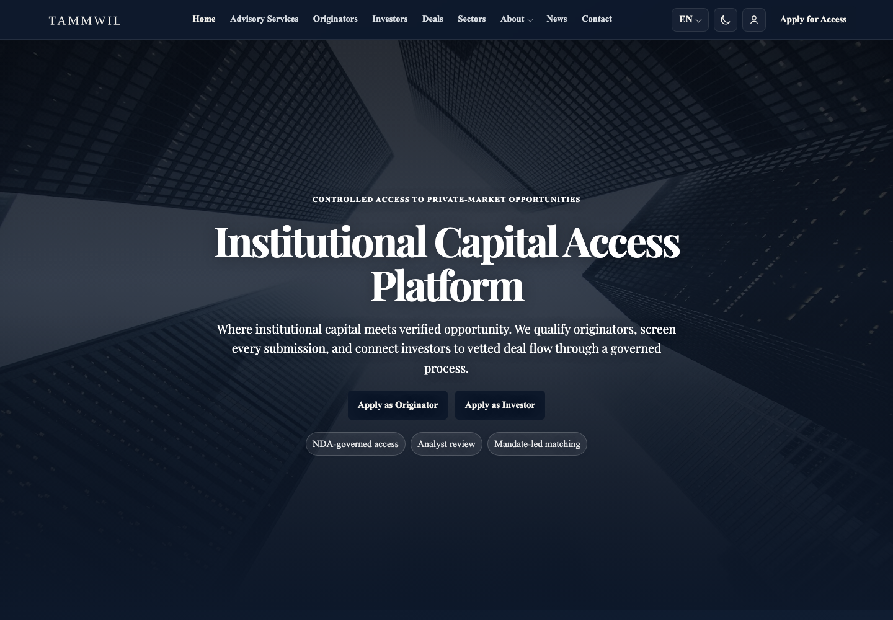

*Live public website, captured on 20 October 2026.*

> Local public candidate. This package presents selected visuals and a work overview; it contains no application source. Publication is pending confirmation of reuse rights for visual assets incorporated in the screenshots. No publication was performed in this review.

## One opportunity, distinct responsibilities

Tammwil is commissioned client software for originators, investors and platform administrators. Originators prepare bilingual opportunities and supporting documents. Administrators review applications, opportunities and access requests. Investors discover published opportunities and request access to associated documents. Public advisory pages provide another entry route through service-specific enquiries.

| Surface | Purpose |
|---|---|
| Public website | Explain the platform, browse opportunities and submit participant or advisory enquiries |
| Originator workspace | Prepare opportunities and follow their documents, review notes and status history |
| Administration | Review participants and opportunities, decide document-access requests and manage public content |
| Investor workspace | Browse published opportunities and track deal-specific access states |

The platform is web-based. Phone screenshots show responsive web layouts; no native mobile or desktop application is claimed.

## Capabilities and evidence

**Observed runtime** means checked in the current browser review. **Verified code** means the implementation was inspected. **Existing demo** identifies an earlier official capture using fictional records; its actions were not repeated in this review.

| Capability | Evidence |
|---|---|
| English/LTR and Arabic/RTL public interfaces; light/dark preferences and mobile navigation | Observed runtime + verified code |
| Participant application form with investor/originator selection | Observed runtime; approval/account preparation verified in code |
| Opportunity catalogue filters, including sector and dependent subsector choices | Observed runtime + verified code |
| Bilingual opportunity submission, supporting files and history | Verified code + existing demo |
| Administrative review, publication states and review notes | Verified code + existing demo |
| Deal-specific NDA request form and document-access decisions | Verified code + existing demo; no agreement signed during this review |
| Document retrieval checks based on role, ownership and approval | Verified code; no current download/security test |
| Advisory service selection carried into a proposal form; separate consultation enquiry | Observed runtime; persistence/admin follow-up verified in code |
| Administration for users, contacts, advisory requests, news, team, pages and translations | Verified code |

## Selected journeys

### Prepare an opportunity

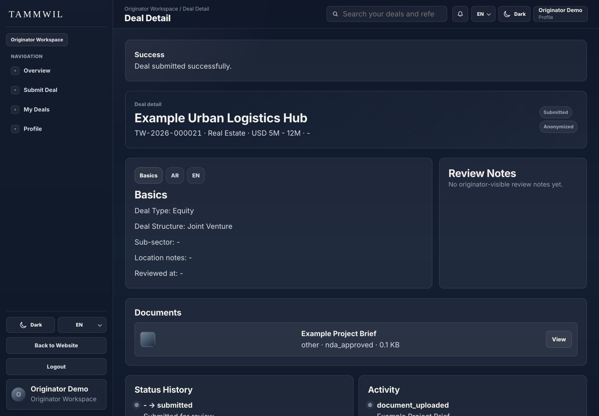

*Existing synthetic demo. The originator workflow brings bilingual information, documents and submission history together. This submission was not executed in the current review.*

### Review its publication state

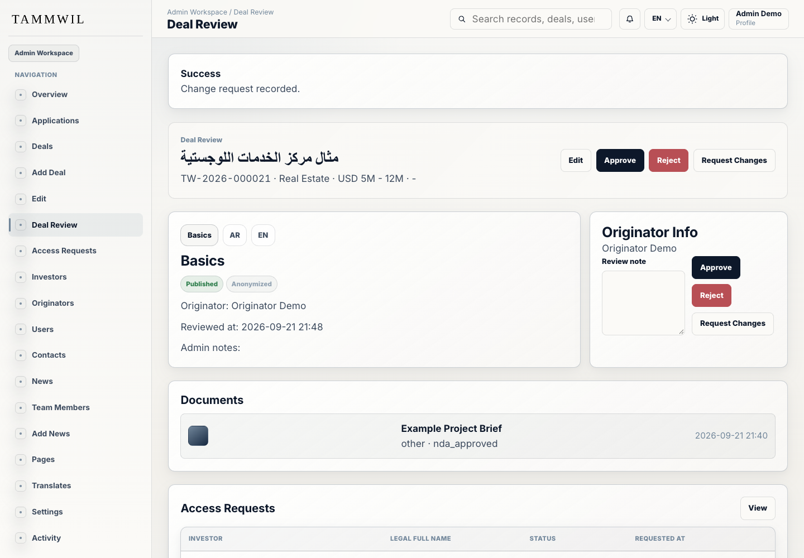

*Existing synthetic demo, light theme. The original notification banner is retained; this image illustrates a review screen and its displayed state, not a newly tested publication action.*

### Request and receive document access

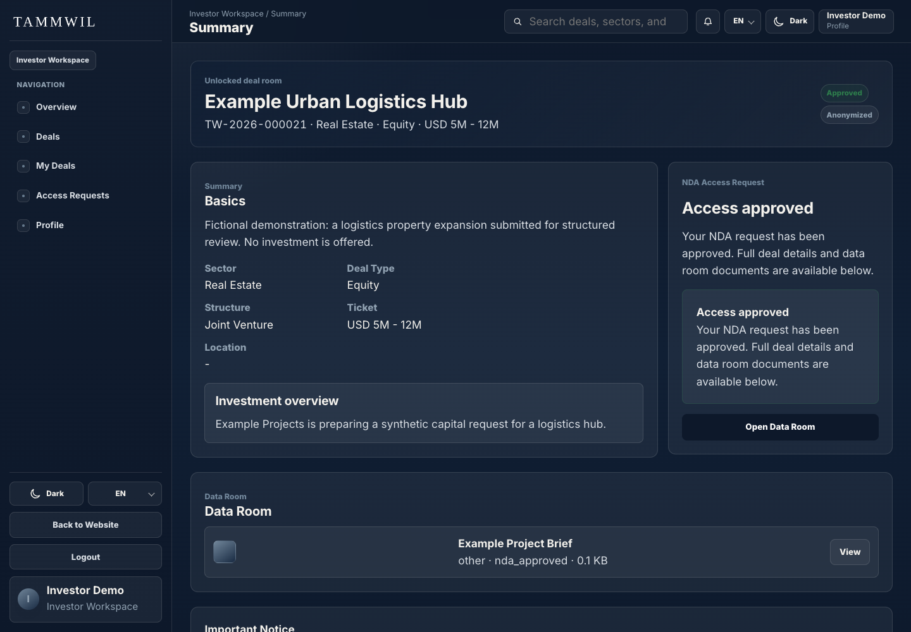

*Existing synthetic demo. Document permission is distinct from publishing descriptive opportunity information. All amounts, participant names and identifiers in these workspace images are fictional.*

View the earlier locked document-request example

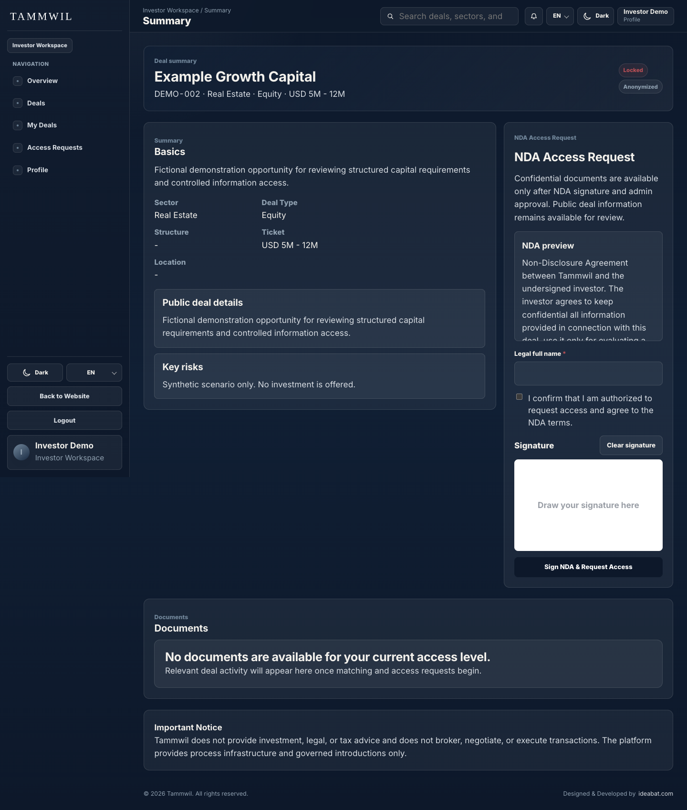

This is a different fictional opportunity from the approved example above. The pair illustrates two states, not a before/after transaction. No signature was entered and no legal agreement was executed in this review.

### Serve English and Arabic audiences

<table>
<tr>
<td align="center">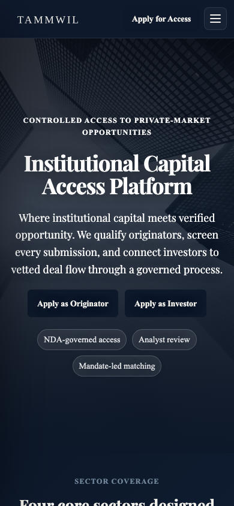</td>
<td align="center">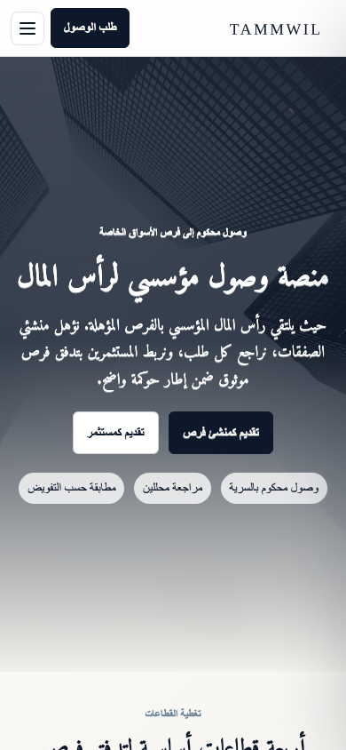</td>
</tr>
<tr><td align="center">English · dark · live capture</td><td align="center">العربية · فاتح · لقطة حية</td></tr>
</table>

View the earlier Arabic investor workspace

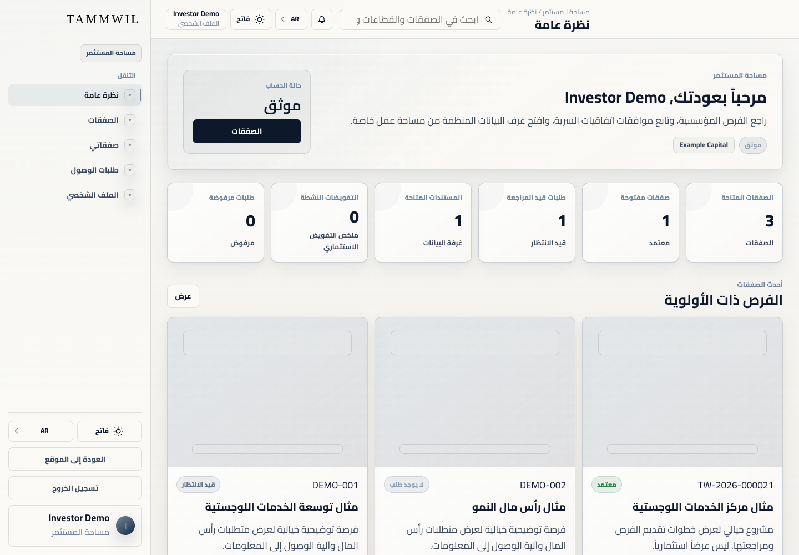

Existing synthetic demo. The counters are illustrative, not production usage metrics. Some labels or opportunity content may retain English fallbacks.

### Carry service context into an enquiry

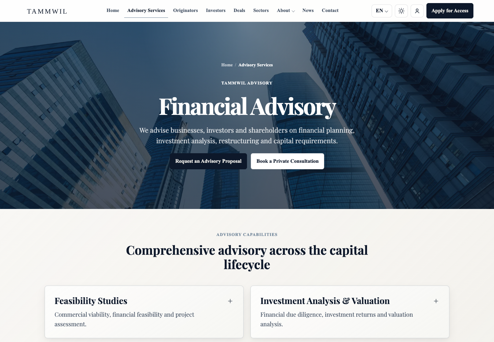

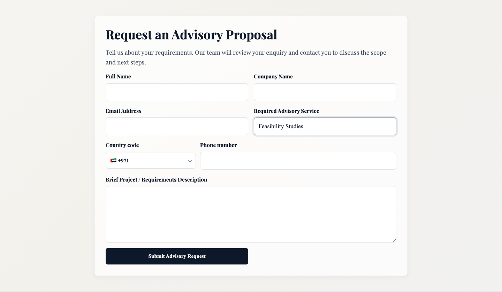

*Current browser journey: expand a service, follow its proposal action, and arrive with that service selected. No form was submitted. “Book a Private Consultation” opens an enquiry form; a calendar reservation is not demonstrated. Advisory offerings are service descriptions, not automated financial-analysis tools.*

View the participant application form

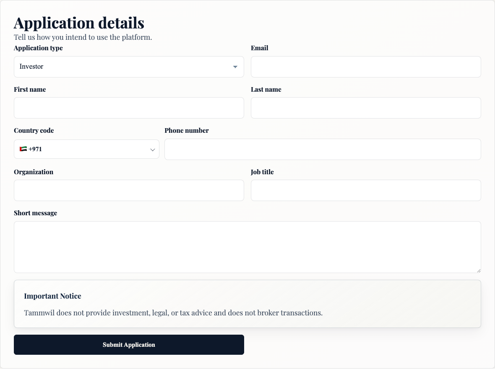

Current public capture. Applicants can choose their role manually. In this review, the homepage's originator action opened the generic form with Investor still selected.

## Architecture and delivery

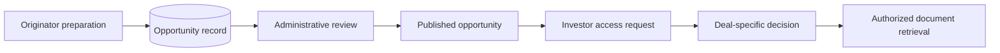

*Conceptual workflow derived from the inspected implementation.*

The application uses PHP, PDO and a MySQL-compatible database, with server-rendered HTML, custom CSS and JavaScript. Shared records connect opportunities, translations, documents, requests and review history. PHPMailer supplies email integration paths; successful live delivery is not asserted.

Delivery scope includes the public website, role workspaces, administration and shared backend. Current verification covered public UI and read-only interactions. The local database was unavailable, so authenticated write workflows were not rerun. Existing official demo visuals remain explicitly labelled. No financial return, adoption metric, automated mandate-matching engine, complete password-reset flow or independent security certification is claimed.

[Image provenance and captions](screenshots/README.md) distinguish all new and existing visuals.

## Related expertise

This work relates to [Web Development](https://ideabat.com/service/web-development/), [Business Dashboards & Automation](https://ideabat.com/service/business-dashboards-automation/) and [Backend & API Development](https://ideabat.com/service/backend-api-development/).

Relevant solution contexts include [Multilingual Website](https://ideabat.com/solution/multilingual-website/), [Client Portal System](https://ideabat.com/solution/client-portal-system/) and [Admin Dashboard](https://ideabat.com/solution/admin-dashboard/).

Read the Arabic [portfolio entry](https://ideabat.com/ar/portfolio/tammwil-private-market-platform/) or [case study](https://ideabat.com/ar/case-study/tammwil-governed-deal-access/). To discuss a related product, [contact Ideabat through its official website](https://ideabat.com/).

---

Project owner and rights holder: **Ramy Azizeh**, as supplied in the project brief. Development credit is separate from ownership.

Built by **[Ragıp Mullamusa](https://ceo.ideabat.com)** and **[Ideabat](https://ideabat.com/)**.

Application source and client materials remain proprietary. This showcase does not grant a software or visual-asset reuse license. Review date: 20 October 2026.
